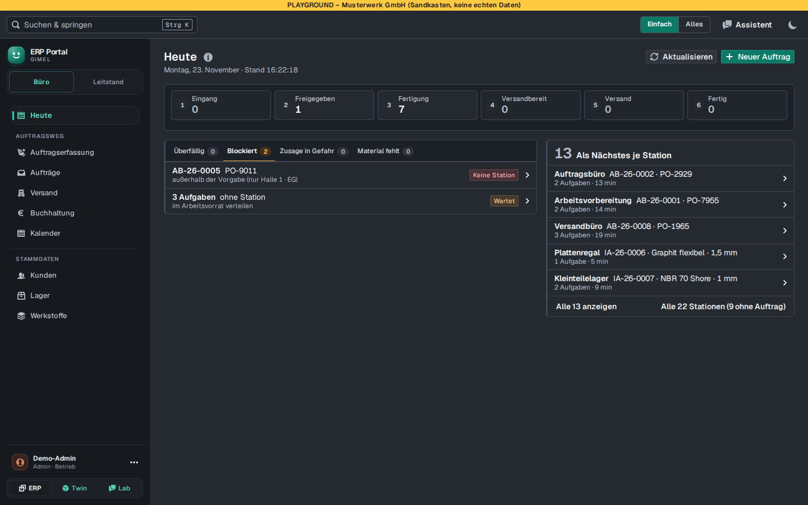
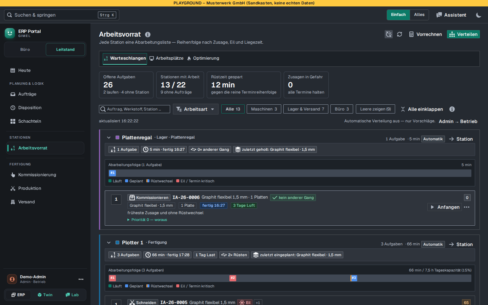
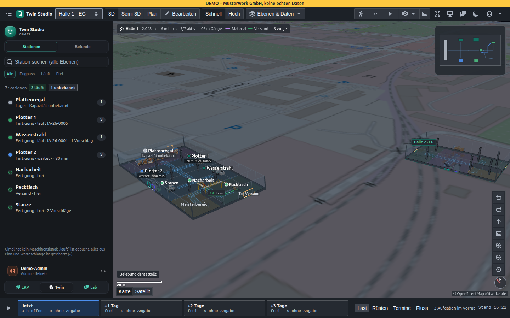
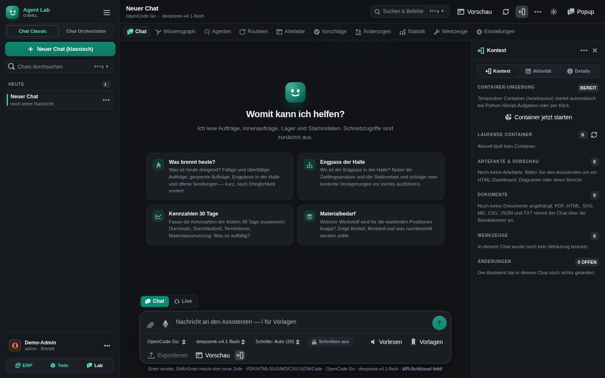
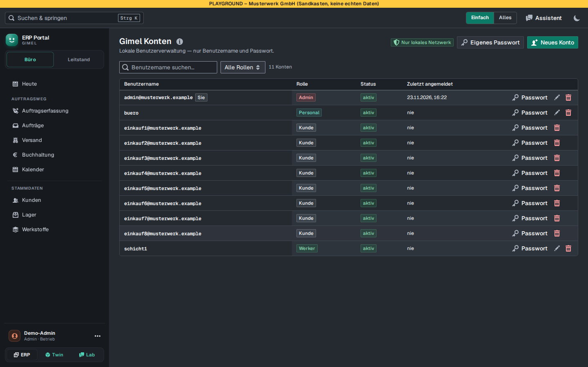

# Gimel — Localnet ERP, 3D Factory Twin & Agent Lab

**Gimel** is a local-first manufacturing ERP, MES, 2D sheet-nesting, 3D factory twin, and AI assistant platform built for sheet-cutting job shops and manufacturers.

- **Localnet-only by default (`GIMEL_LOCALNET_ONLY=1`)** — Restricted to loopback & private LAN subnets (`127.0.0.0/8`, `10.0.0.0/8`, `172.16.0.0/12`, `192.168.0.0/16`, ULA); blocks public peers and public proxy headers with `403`.
- **Simple Account Manager (Username + Password)** — Local accounts via `/app#/benutzer`, `/api/accounts`, or `gimel accounts`, with browser-based first-run admin setup on empty databases.
- **Always ships with both modes:**
  - **Playground (`:8040`)** — Isolated sandbox pre-seeded with *Musterwerk GmbH* (`--reset` anytime).
  - **Production (`:8041`)** — Clean database (SQLite or PostgreSQL), strict production security, `/docs` disabled.
- **Built-in GitHub Release Updater** — Check and update directly from `mxsp/gimel` releases in **Admin → Updates** or via `gimel update`.

> **Manual:** See the complete [Installation & User Manual](./docs/MANUAL.md) for step-by-step setup, daily workflows, account administration, updates, and backups.  
> **License:** Source-available for **non-commercial use only** (see [LICENSE](./LICENSE)). Commercial use requires a separate license.

---

## Showcase

### ERP Portal — Daily Dashboard & Shop-Floor Control (`/app`)
Manage quotes, orders, automated 2D sheet nesting (`lite` & `kerf`), disposition, station worklists (`Arbeitsvorrat` & `Arbeitsplätze`), picking, production, shipping, inventory, and invoicing in one fast interface.





### 3D Factory Twin Studio (`/studio`) & Floor Plan (`/twin`)
Visualize live station status, edit hall layouts, machines, aisles, and storage zones in interactive 2D/3D, and save camera presets.



### Gimel Agent Lab (`/lab`) & Docked Copilot
Connect a local LLM (such as Ollama on your LAN) or cloud provider to inspect orders, schedules, stock, and factory data with tool execution and reversible change tracking.



### Localnet Account Manager (`#/benutzer`)
Create and manage local `Admin`, `Personal`, and `Werker` logins using only **Username + Password** — no mail server or external directory needed.



---

## One-Time Setup & Quick Start

### Option 1: One-Time Setup Script (Recommended for Local / LAN Install)

Run once to create `.venv`, install Gimel, build all SPAs (`/app`, `/studio`, `/twin`, `/lab`), and initialize both Playground and Production:

**Linux / macOS:**
```bash
git clone https://github.com/mxsp/gimel.git
cd gimel
./scripts/setup.sh
```

**Windows (PowerShell):**
```powershell
git clone https://github.com/mxsp/gimel.git
cd gimel
.\scripts\setup.ps1
```

Then start Gimel:
```bash
.venv/bin/gimel playground                      # Demo sandbox on http://127.0.0.1:8040/app
.venv/bin/gimel production                      # Clean production on http://127.0.0.1:8041/app
.venv/bin/gimel production --host 0.0.0.0       # Share over your local LAN (localnet-only enforced)
```

### Option 2: Standalone Executable (Linux Binary / Windows `.exe`)

Download from [GitHub Releases](https://github.com/mxsp/gimel/releases) or build locally (`./packaging/build-exe.sh` on Linux, `.\packaging\build-exe.ps1` on Windows):

```bash
./packaging/dist/gimel --mode playground   # Sandbox on http://127.0.0.1:8040/app
./packaging/dist/gimel --mode production   # Clean production on http://127.0.0.1:8041/app
./packaging/dist/gimel --mode both         # Run both side by side
```

### Option 3: Docker Compose (Playground + Production + PostgreSQL)

```bash
cp .env.example .env
# Edit .env to set POSTGRES_PASSWORD, GIMEL_SECRET_KEY, GIMEL_ADMIN_USER, and GIMEL_ADMIN_PASSWORD
docker compose up -d --build
```

- Playground: `http://127.0.0.1:8040/app` (`docker logs gimel-playground` prints demo credentials)
- Production: `http://127.0.0.1:8041/app` (PostgreSQL 16)

---

## Account Manager & Updates (CLI)

```bash
# Manage local username + password accounts
gimel accounts list
gimel accounts add max --role staff
gimel accounts passwd max
gimel accounts role max admin
gimel accounts disable max | enable max | unlock max | delete max

# Check & apply updates from GitHub Releases (mxsp/gimel)
gimel update --check
gimel update --apply
```

---

## Repository Layout

```text
gimel/                FastAPI backend, planning core, localnet guard, account manager, updater
  core/               Pure planning & geometry: nesting (lite/kerf), routing, worklist, pricing
  routers/            REST API endpoints (/api/accounts, /api/updates, /api/orders, ...)
  services/           Domain services, batch scheduler, GitHub Release updater, settings store
  localnet.py         Localnet-only ASGI middleware (loopback + RFC1918 + ULA)
  launcher.py         Unified Playground & Production runner (CLI, Docker, EXE)
web/                  React 18 + Blueprint 5 frontend (Portal /app, Twin /twin, Studio /studio)
agentlab/             Optional AI assistant backend & frontend (/lab)
scripts/              One-time setup scripts (setup.sh, setup.ps1)
packaging/            PyInstaller spec and Linux/Windows executable build scripts
docs/                 MANUAL.md, MODULARITY.md, and screenshots/
tests/                Pytest backend, security, updater, and planning test suites
```

---

## Documentation

- [Installation & User Manual](./docs/MANUAL.md)
- [Modularity & Extension Guide](./docs/MODULARITY.md)
- [Security Policy](./SECURITY.md)
- [Contributing](./CONTRIBUTING.md)
- [Third-Party Licenses](./THIRD_PARTY_LICENSES.md)

---

## License

Copyright (c) 2026 FyreFly Systems GbR / mxsp.  
Licensed under the **Gimel Non-Commercial Source License** — see [LICENSE](./LICENSE).
